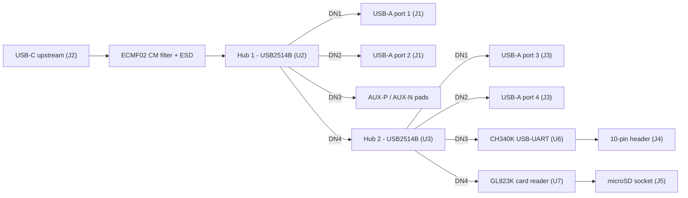

# USB Hub · microSD Reader · USB-UART — V2

A compact USB 2.0 Hi-Speed expansion board. A single USB Type-C upstream connection provides **four USB Type-A ports**, a **microSD card reader** and a **USB-to-UART bridge** with a 10-pin header. Everything fits on a 90 × 55 mm four-layer PCB designed in KiCad 10.

  

## Features

- **USB Type-C upstream port**: USB 2.0, reversible, with 5.1 kΩ pull-downs on CC1/CC2 so any USB-C host or charger turns on VBUS
- **Two cascaded Microchip USB2514B hubs**: 4-port, USB 2.0 Hi-Speed (480 Mbit/s) controllers
- **4 × USB Type-A downstream ports** on two dual stacked connectors
- **1 spare downstream port** on the `AUX-P` / `AUX-N` pads
- **microSD card reader** based on the Genesys Logic GL823K, which works as a standard USB Mass Storage device with no driver needed
- **USB ⇄ UART bridge** based on the WCH CH340K, with `TXD`, `RXD`, `RTS`, `CTS`, `DTR`, 3.3 V and 5 V on a 2.54 mm header
- **Port power switching**: AP22966 load switches driven by the hub (default), or PTC resettable fuses (fuse variant)
- **Protection**:
  - common-mode filter with built-in ESD protection on every external USB data pair
  - TVS diodes on every power rail and on the UART lines
  - resettable fuses on the input and on the header supply pins
- **Status LEDs** for port power, UART bridge power and SD card activity

## Block diagram

  

USB topology:

## Circuit description

The full schematics are available as PDF files:

- [Main circuit schematics (default variant, with load switches)](gerber-%20documentation/USB%20HUB%20SD%20UART%20V2_%20%20main%20circuit%20schematics.pdf)
- [Fuse variant circuit schematics](gerber-%20documentation/USB%20HUB%20SD%20UART%20V2_%20fuse%20variant%20circuit%20schematics.pdf)

| Sheet | File | Content |
|---|---|---|
| 1 | `alimentazione_e_schema_a_blocchi.kicad_sch` | Block diagram, USB-C input, protection, 3.3 V LDO |
| 2 | `USB HUB SD v2.kicad_sch` | Two USB2514B hubs, port power switching, USB-A connectors |
| 3 | `ch349g.kicad_sch` | CH340K USB-UART bridge and UART header |
| 4 | `adattatori.kicad_sch` | Auxiliary parts: FT232RL and MIC2026 (not fitted), EMI7–EMI9, fiducials |
| 5 | `sd_card.kicad_sch` | GL823K card reader and microSD socket |

### Power input and protection (sheet 1)

- **J2** (Amphenol 12402012E212A) is a USB 2.0 Type-C receptacle. The D+/D− contacts of both rows are tied together, so the cable works in either orientation.
- **R25 and R27** (5.1 kΩ) pull CC1 and CC2 down, so the board is seen as a sink. The board does not negotiate USB Power Delivery.
- **Connector shield**: tied to GND through R26 (1 MΩ) in parallel with C25 (10 nF / 1 kV).
- **VBUS** goes through **F7** (Littelfuse 1206L150THWR PTC resettable fuse, 1.5 A hold) to make the **+5 V** rail. **D13** (SMBJ5.0A TVS) clamps transients on +5 V.
- **Upstream data pair**: filtered by **EMI6** (ST ECMF02-2AMX6, a common-mode filter with built-in ESD protection).
- **U1** (onsemi NCP1117ST33T3G LDO) makes the **+3.3 V** rail from +5 V. The 3.3 V rail is split by two 0 Ω links:
  - R28 feeds **+3V3_HUB** (the two USB2514B controllers).
  - R30 feeds **+3V3_CH340** (the CH340K and the 3.3 V pin of the UART header).

  The links let you isolate either load or measure its current.

### USB hub (sheet 2)

Two **USB2514B-I/M2** controllers (U2, U3) are connected in cascade. Each one has:

- a 24 MHz crystal (Epson TSX-3225, Y1/Y2) with 18 pF load capacitors
- a 12 kΩ RBIAS resistor
- 12 kΩ strap resistors on `CFG_SEL0`, `CFG_SEL1` and `NON_REM`, which select the hardware default configuration, so no EEPROM or SMBus setup is needed
- local decoupling on every 3.3 V supply pin

| Hub | Downstream port | Destination |
|---|---|---|
| U2 (hub 1) | DN1 | J1, port 1 (via EMI2) |
| U2 (hub 1) | DN2 | J1, port 2 (via EMI3) |
| U2 (hub 1) | DN3 | `AUX-P` / `AUX-N` pads (data lines only) |
| U2 (hub 1) | DN4 | Upstream port of U3 (via R12/R13, 0 Ω) |
| U3 (hub 2) | DN1 | J3, port 3 (via EMI4) |
| U3 (hub 2) | DN2 | J3, port 4 (via EMI5) |
| U3 (hub 2) | DN3 | CH340K USB-UART bridge (via R35/R36, 0 Ω) |
| U3 (hub 2) | DN4 | GL823K card reader (via R37/R38, 0 Ω) |

The external ports use two **Molex 67298-4091** dual stacked USB Type-A receptacles (J1, J3). Each port has:

- an **ECMF02-2AMX6** common-mode filter with ESD protection on D+/D−
- an **SMBJ5.0A** TVS on its VBUS line (D15, D18, D19, D20)
- a **VBUS LED** (D3, D16, D14, D17)

The shields of both connectors go to GND through the same 1 MΩ ‖ 10 nF / 1 kV network as the USB-C connector.

### Downstream port power: two assembly variants

The PCB supports two ways of powering the USB-A ports. They are defined as KiCad variants of the same design.

| | **Default (load switch)** | **Fuse variant** (`fusibili porte USB`) |
|---|---|---|
| Port power device | **U10, U11** (Diodes AP22966DC8-7, dual-channel load switch) | **F2, F11, F3, F12** (Littelfuse 1206L150THWR PTC, 1.5 A hold) |
| Control | Hub `PRTPWR1`/`PRTPWR2` drive `EN1`/`EN2` through R17, R43, R39 and R46 (0 Ω) | None: the ports are always powered |
| Behaviour | The hub switches each port on and off. Capacitors on the soft-start (`SS`) pins limit inrush current at turn-on | Each port has its own resettable overcurrent protection |
| Parts not fitted | F2, F3, F11, F12 | U10, U11 and their support parts |

### USB-UART bridge (sheet 3)

- **U6** is a **WCH CH340K**, which has a built-in oscillator. It runs from **+3V3_CH340** (`VCC` and `V3` tied together), so **all UART signals use 3.3 V logic levels**.
- **D4–D8** (Littelfuse SP4020-01FTG-C TVS) protect each UART line.
- The header supply pins are protected by PTC fuses (F4 for 3.3 V, F5 for 5 V) and SMBJ5.0A TVS diodes (D10, D11).
- **D12** shows that the bridge is powered.

**J4 – 2.54 mm 1×10 header pinout**

| Pin | Signal | Notes |
|---|---|---|
| 1 | +3V3 | From +3V3_CH340 through F4 (PTC) |
| 2 | DTR# | Output |
| 3 | GND | |
| 4 | RTS# | Output |
| 5 | CTS# | Input |
| 6 | GND | |
| 7 | TXD | CH340K transmit (connect to the target's RX) |
| 8 | RXD | CH340K receive (connect to the target's TX) |
| 9 | GND | |
| 10 | +5V | From +5 V through F5 (PTC) |

> **Note:** the 3.3 V header pin shares the NCP1117 LDO with the hub controllers. To power larger loads, use the 5 V pin.

### microSD card reader (sheet 5)

- **U7** is a **Genesys Logic GL823K**, a USB 2.0 SD card reader controller. It runs from +5 V and makes its own 3.3 V supply internally (decoupled by C21 and C22), and needs no external crystal.
- The card supply (`SUPPLY_CARD`) comes from the controller's internal power switch (`PMOS` pin).
- The 4-bit SD bus (`CLK`, `CMD`, `D0`–`D3`) goes directly to **J5**, a microSD socket (MSD-4-A).
- **D9** is the card activity LED (GL823K `LED` pin).
- The socket's card-detect switch is available on test point **TP3**.

### Indicators and test points

| Ref | Function |
|---|---|
| D3, D16 | VBUS present on J1 ports 1 and 2 |
| D14, D17 | VBUS present on J3 ports 3 and 4 |
| D12 | CH340K powered (+3V3_CH340) |
| D9 | microSD activity |
| TP2 | VBUS from USB-C, before fuse F7 |
| TP59 | +5 V rail, after fuse F7 |
| TP3 | microSD card-detect switch |
| AUX-P / AUX-N | D+ / D− of the spare hub port (U2 DN3) |

## Main components

| Ref | Part | Function |
|---|---|---|
| U2, U3 | Microchip USB2514B-I/M2 | 4-port USB 2.0 Hi-Speed hub controller |
| U6 | WCH CH340K | USB ⇄ UART bridge |
| U7 | Genesys Logic GL823K | USB 2.0 SD/microSD card reader controller |
| U1 | onsemi NCP1117ST33T3G | 3.3 V LDO regulator |
| U10, U11 | Diodes AP22966DC8-7 | Dual-channel load switch for port VBUS (default variant) |
| F2, F3, F11, F12 | Littelfuse 1206L150THWR | Port VBUS PTC fuses (fuse variant) |
| F4, F5, F7 | Littelfuse 1206L150THWR | Input and header PTC fuses |
| EMI2–EMI6 | ST ECMF02-2AMX6 | Common-mode filter + ESD protection for USB data lines |
| D4–D8 | Littelfuse SP4020-01FTG-C | ESD TVS on UART lines |
| D10, D11, D13, D15, D18–D20 | Vishay SMBJ5.0A-E3/52 | 600 W TVS on supply rails |
| J2 | Amphenol 12402012E212A | USB Type-C receptacle (upstream) |
| J1, J3 | Molex 67298-4091 | Dual stacked USB Type-A receptacle |
| J5 | MSD-4-A | microSD socket |
| J4 | 2.54 mm 1×10 header | UART + supply header |
| Y1, Y2 | Epson TSX-3225 24.0000 MHz | Hub reference crystals |

The complete bill of materials is in [`BOM_USB_HUB_SD v2.xlsx`](gerber-%20documentation/BOM_USB_HUB_SD%20v2.xlsx).

## PCB

  

| Parameter | Value |
|---|---|
| Layers | 4 (F.Cu, In1.Cu, In2.Cu, B.Cu) |
| Board size | 90.4 × 55.5 mm, rounded corners |
| Upstream connector | USB Type-C (USB 2.0) |
| Downstream connectors | 2 × dual stacked USB Type-A, 1 × microSD, 1 × 10-pin 2.54 mm header |
| Supply | Bus-powered, 5 V from the upstream VBUS |
| EDA tool | KiCad 10.0 |

The PCB layer plots are in [`USB HUB SD v2 layer plot.pdf`](gerber-%20documentation/USB%20HUB%20SD%20v2%20layer%20plot.pdf).

## Repository contents

| Path | Description |
|---|---|
| `USB HUB SD v2.kicad_pro` | KiCad 10 project file |
| `USB HUB SD v2.kicad_sch` and sub-sheets | Hierarchical schematic (see the sheet table above) |
| `USB HUB SD v2.kicad_pcb` | PCB layout |
| `HUB USB v2.step`, `hub_USB.glb` | 3D models of the assembled board |
| `fabrication-toolkit-options.json` | Settings for the KiCad Fabrication Toolkit plugin |
| `gerber- documentation/gerber USB_HUB_SD_UART_V2.zip` | Gerber manufacturing files |
| `gerber- documentation/BOM_USB_HUB_SD v2.xlsx` | Bill of materials |
| `gerber- documentation/*.pdf` | Schematics (both variants) and PCB layer plots |
| `images/` | Pictures used in this README |

## Usage

1. Connect the USB-C port to a computer with a USB-C cable, or with a USB-A to USB-C cable.
2. The operating system finds two USB hubs, a **CH340 serial port**, and a **USB Mass Storage** device for the microSD reader.
3. The CH340 driver is built into Linux and macOS. Windows usually installs it automatically through Windows Update; if it doesn't, download it from the WCH website.
4. Plug USB devices into the four Type-A ports. They all share the 5 V supply from the upstream port.

> **Power budget:** the board does not negotiate USB Power Delivery. The total current available to all ports is limited by the host port or power source and by the input PTC fuse F7 (1.5 A hold current).

## Author

Designed by **Gabriele Marocco**, [PCB Semplice](https://pcbsemplice.com).
